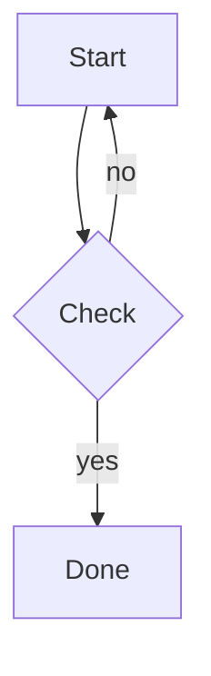

# H1 — Markdown Stress Test

## H2 — Headings

### H3 — Third level

#### H4 — Fourth level

##### H5 — Fifth level

###### H6 — Sixth level

## Duplicate Heading

Text under the first duplicate heading.

## Duplicate Heading

Text under the second duplicate heading (anchor IDs must not collide).

## Heading with `inline code`, **bold**, *italic*, and a [link](https://example.com)

## Heading: With — Special & Characters (Parentheses) / Slashes? #hash

## Ünïcödé Héädïng — 日本語 — العربية — Русский — 🚀

Setext H1
=========

Setext H2
---------

---

## Inline Formatting

Plain, *italic*, _italic_, **bold**, __bold__, ***bold italic***, ~~strikethrough~~, `inline code`, ==highlight (non-standard)==, H~2~O (non-standard), x^2^ (non-standard).

Nested: **bold with *italic inside* and `code inside`** and ~~strike with **bold**~~.

Escapes: \*not italic\*, \_not italic\_, \`not code\`, \# not heading, \[not link\], 1\. not list, \\ backslash, \<not html\>.

Hard line break with two trailing spaces:  
second line.

Hard line break with backslash:\
second line.

Soft line break
in source only.

Keyboard: <kbd>Ctrl</kbd> + <kbd>Shift</kbd> + <kbd>P</kbd>. Subscript <sub>sub</sub>, superscript <sup>sup</sup>, <mark>mark</mark>, <abbr title="HyperText Markup Language">HTML</abbr>.

## Links

- Inline: [Example](https://example.com "With Title")
- Reference: [Reference link][ref-1] and [Case Insensitive][REF-1]
- Relative: [Sibling](./other.md), [Anchor](#duplicate-heading), [Parent](../index.md)
- Autolink: <https://example.com/autolink> and bare https://example.com/bare-url and <mailto:test@example.com>
- Very long URL: [long](https://example.com/aaaaaaaaaaaaaaaaaaaaaaaaaaaaaaaaaaaaaaaaaaaaaaaaaaaaaaaaaaaaaaaaaaaaaaaaaaaaaaaaaaaaaaaaaaaaaaaaaaaaaaaaaaaaaaaaaaaaaaaaaaaaaaaaaaaaaa?query=1&other=2#fragment)


[ref-1]: https://example.com/reference "Reference Title"

## Lists

### Unordered

- Item one
- Item two
  - Nested level 2
    - Nested level 3
      - Nested level 4
        - Nested level 5
          - Nested level 6
- Item three

* Asterisk marker
+ Plus marker

### Ordered

1. First
2. Second
   1. Nested ordered
   2. Nested ordered
      - Mixed unordered inside ordered
3. Third

5. Starts at five
6. Six
7. Seven

1. All
1. Ones
1. Numbering

### Task List

- [x] Completed task
- [ ] Incomplete task
  - [x] Nested completed
  - [ ] Nested incomplete
- [ ] Task with `code`, **bold**, and a [link](https://example.com)

### Loose List (paragraphs inside items)

- First item paragraph.

  Second paragraph inside first item.

  ```ts
  const insideList: number = 1;
  ```

- Second item.

  > Blockquote inside list item.

### Definition-Style (non-standard)

Term
: Definition of term

### Long Items

- Lorem ipsum dolor sit amet, consectetur adipiscing elit, sed do eiusmod tempor incididunt ut labore et dolore magna aliqua. Ut enim ad minim veniam, quis nostrud exercitation ullamco laboris nisi ut aliquip ex ea commodo consequat. Duis aute irure dolor in reprehenderit in voluptate velit esse cillum dolore eu fugiat nulla pariatur.
- Short item after a long one.

## Blockquotes

> Single-line quote.

> Multi-line quote
> continues here.
>
> Second paragraph in quote.

> Level 1
>
> > Level 2
> >
> > > Level 3
> > >
> > > > Level 4

> **Quote with formatting**
>
> - List inside quote
> - Another item
>
> ```bash
> npm install
> ```
>
> | A | B |
> |---|---|
> | 1 | 2 |

> [!NOTE]
> GitHub-style alert: note.

> [!TIP]
> GitHub-style alert: tip.

> [!IMPORTANT]
> GitHub-style alert: important.

> [!WARNING]
> GitHub-style alert: warning.

> [!CAUTION]
> GitHub-style alert: caution.

## Code

Inline: `const x: number = 1;`, `` `backticks` inside ``, `<div className="a">`, `{{ braces }}`, `${template}`.

### No Language

```
plain text fence
  indented line
no highlighting expected
```

### TypeScript

```ts
type Result<T, E extends Error = Error> =
  | { readonly ok: true; readonly value: T }
  | { readonly ok: false; readonly error: E };

export async function fetchJson<T>(
  url: string,
  init?: RequestInit & { signal?: AbortSignal },
): Promise<Result<T>> {
  try {
    const res = await fetch(url, init);
    if (!res.ok) {
      return { ok: false, error: new Error(`HTTP ${res.status}`) };
    }
    return { ok: true, value: (await res.json()) as T };
  } catch (error: unknown) {
    return {
      ok: false,
      error: error instanceof Error ? error : new Error(String(error)),
    };
  }
}
```

### TSX

```tsx
"use client";

import { useCallback, useId, useState, type ComponentPropsWithoutRef } from "react";

interface CounterProps extends ComponentPropsWithoutRef<"button"> {
  readonly initial?: number;
  readonly onChange?: (value: number) => void;
}

export function Counter({ initial = 0, onChange, className, ...rest }: CounterProps) {
  const id = useId();
  const [count, setCount] = useState<number>(initial);

  const increment = useCallback(() => {
    setCount((prev) => {
      const next = prev + 1;
      onChange?.(next);
      return next;
    });
  }, [onChange]);

  return (
    <button
      id={id}
      type="button"
      aria-live="polite"
      className={`rounded-md border px-3 py-1 text-sm ${className ?? ""}`}
      onClick={increment}
      {...rest}
    >
      Count: {count}
    </button>
  );
}
```

### JavaScript

```js
const debounce = (fn, ms = 200) => {
  let t;
  return (...args) => {
    clearTimeout(t);
    t = setTimeout(() => fn.apply(this, args), ms);
  };
};
```

### JSON

```json
{
  "name": "stress-test",
  "version": "1.0.0",
  "private": true,
  "scripts": { "dev": "next dev", "build": "next build" },
  "nested": { "array": [1, 2.5, -3, 1e10, null, true, false, "string"] }
}
```

### Shell

```bash
#!/usr/bin/env bash
set -euo pipefail

npm install
npm run build -- --filter=@scope/pkg
echo "Done: $(date -u +%FT%TZ)" | tee -a build.log
```

### CSS

```css
:root {
  --bg: #0a0a0a;
  --fg: oklch(0.98 0 0);
}

@media (prefers-color-scheme: light) {
  :root { --bg: #fff; --fg: #111; }
}

.card:where(:hover, :focus-visible) > .title::after {
  content: "→";
  transform: translateX(calc(var(--gap, 4px) * 2));
}
```

### HTML

```html
<!doctype html>
<html lang="en">
  <head><meta charset="utf-8" /><title>Test</title></head>
  <body><main id="app" data-x='{"a":1}'><!-- comment --></main></body>
</html>
```

### YAML

```yaml
name: ci
on:
  push:
    branches: [main]
jobs:
  test:
    runs-on: ubuntu-latest
    steps:
      - uses: actions/checkout@v4
      - run: npm ci && npm test
```

### SQL

```sql
SELECT u.id, COUNT(p.id) AS posts
FROM users u
LEFT JOIN posts p ON p.user_id = u.id AND p.deleted_at IS NULL
WHERE u.created_at >= NOW() - INTERVAL '30 days'
GROUP BY u.id
HAVING COUNT(p.id) > 5
ORDER BY posts DESC
LIMIT 10;
```

### Python

```python
from dataclasses import dataclass

@dataclass(frozen=True)
class Point:
    x: float
    y: float

    def dist(self, other: "Point") -> float:
        return ((self.x - other.x) ** 2 + (self.y - other.y) ** 2) ** 0.5
```

### Diff

```diff
- const old = require("old");
+ import next from "next";
  export default function Page() {
-   return <Old />;
+   return <New />;
  }
```

### Code Block Edge Cases

Very long single line (horizontal scroll, no layout overflow):

```ts
const veryLongLine = "aaaaaaaaaaaaaaaaaaaaaaaaaaaaaaaaaaaaaaaaaaaaaaaaaaaaaaaaaaaaaaaaaaaaaaaaaaaaaaaaaaaaaaaaaaaaaaaaaaaaaaaaaaaaaaaaaaaaaaaaaaaaaaaaaaaaaaaaaaaaaaaaaaaaaaaaaaaaaaaaaaaaaaaaaaaaaaaaaaaaaaaaaaaaaaaaaaaaaaaaaaaaaaaaaaaaaaaaaaaaaaaaaaaaaaaaaaaaaaaaaaaaaaaaaaaaaaaaaaaaaaaaaaaaaaa";
```

Empty code block:

```
```

Unknown language:

```notalanguage
some content
```

Language with meta string:

```ts title="example.ts" {2,4-5} showLineNumbers
const a = 1;
const b = 2; // highlighted
const c = 3;
const d = 4; // highlighted
const e = 5; // highlighted
```

Fence containing fences (four backticks outer):

````md
```ts
const nested = true;
```
````

Tilde fence:

~~~js
console.log("tilde fence");
~~~

Indented code block:

    indented four spaces
    still code

Code with trailing whitespace and tabs:

```
	tab-indented line
trailing spaces   
```

Large block (50 lines, scroll/height behavior):

```ts
export const lines = [
  "line 01", "line 02", "line 03", "line 04", "line 05",
  "line 06", "line 07", "line 08", "line 09", "line 10",
  "line 11", "line 12", "line 13", "line 14", "line 15",
  "line 16", "line 17", "line 18", "line 19", "line 20",
  "line 21", "line 22", "line 23", "line 24", "line 25",
  "line 26", "line 27", "line 28", "line 29", "line 30",
  "line 31", "line 32", "line 33", "line 34", "line 35",
  "line 36", "line 37", "line 38", "line 39", "line 40",
  "line 41", "line 42", "line 43", "line 44", "line 45",
  "line 46", "line 47", "line 48", "line 49", "line 50",
] as const;
```

## Tables

| Left | Center | Right |
| :--- | :----: | ----: |
| L1 | C1 | R1 |
| L2 | C2 | R2 |

| Feature | `inline code` | **Bold** | [Link](https://example.com) |
|---|---|---|---|
| Pipes \| escaped | a \| b | `a \| b` | — |
| Empty cell | | | |
| Emoji | ✅ | ❌ | ⚠️ |

Wide table (horizontal overflow on mobile):

| Col 1 | Col 2 | Col 3 | Col 4 | Col 5 | Col 6 | Col 7 | Col 8 | Col 9 | Col 10 | Col 11 | Col 12 |
|---|---|---|---|---|---|---|---|---|---|---|---|
| aaaaaaaaaaaaaaaa | bbbbbbbbbbbbbbbb | cccccccccccccccc | dddddddddddddddd | eeeeeeeeeeeeeeee | ffffffffffffffff | gggggggggggggggg | hhhhhhhhhhhhhhhh | iiiiiiiiiiiiiiii | jjjjjjjjjjjjjjjj | kkkkkkkkkkkkkkkk | llllllllllllllll |

Table with long unbroken cell:

| Key | Value |
|---|---|
| hash | aaaaaaaaaaaaaaaaaaaaaaaaaaaaaaaaaaaaaaaaaaaaaaaaaaaaaaaaaaaaaaaaaaaaaaaaaaaaaaaaaaaaaaaaaaaaaaaaaaaaaaaaaaaaaaaaaaaaaaaaaaaaaaaaaa |
| multi-word | Lorem ipsum dolor sit amet, consectetur adipiscing elit, sed do eiusmod tempor incididunt ut labore et dolore magna aliqua. |

Single-column table:

| Only |
|---|
| one |

## Horizontal Rules

---

***

___

- - -

## Footnotes

Footnote reference one[^1], another[^named], and a long one[^long].

[^1]: Simple footnote.
[^named]: Named footnote with `code` and a [link](https://example.com).
[^long]: Long footnote.

    With a second indented paragraph.

## Raw HTML

<details>
<summary>Collapsible section (click to expand)</summary>

Hidden **markdown** content inside details.

```ts
const hidden = true;
```

</details>

<div align="center">

**Centered block with markdown inside HTML**

</div>

<p align="right">Right-aligned paragraph</p>

<table>
  <thead><tr><th>HTML</th><th>Table</th></tr></thead>
  <tbody><tr><td>cell</td><td>cell</td></tr></tbody>
</table>

<!-- HTML comment: must not render -->


<iframe src="https://example.com" width="300" height="100" title="iframe test"></iframe>

## Math (remark-math / KaTeX, if enabled)

Inline: $E = mc^2$ and $\sum_{i=1}^{n} i = \frac{n(n+1)}{2}$.

Block:

$$
\int_{-\infty}^{\infty} e^{-x^2}\,dx = \sqrt{\pi}
$$

## Diagrams (mermaid, if enabled)



## Text Edge Cases

### Unbroken Strings

AAAAAAAAAAAAAAAAAAAAAAAAAAAAAAAAAAAAAAAAAAAAAAAAAAAAAAAAAAAAAAAAAAAAAAAAAAAAAAAAAAAAAAAAAAAAAAAAAAAAAAAAAAAAAAAAAAAAAAAAAAAAAAAAAAAAAAAAAAAAAAAAAAAAAAAAAAAAAAAAAAAAAAAAAAAAAAAAAAAAAAAAAAAAAAAAAAAAAAAAAAAAA

`inline-code-with-a-very-long-unbroken-string-that-should-wrap-or-scroll-without-breaking-the-layout-aaaaaaaaaaaaaaaaaaaaaaaaaaaaaaaaaaaaaaaaaaaaaaaaaaaaaaaaaaaaaaaaaaaaaaaaaaaaaaaaaaaaaaaa`

### Long Paragraph

Lorem ipsum dolor sit amet, consectetur adipiscing elit, sed do eiusmod tempor incididunt ut labore et dolore magna aliqua. Ut enim ad minim veniam, quis nostrud exercitation ullamco laboris nisi ut aliquip ex ea commodo consequat. Duis aute irure dolor in reprehenderit in voluptate velit esse cillum dolore eu fugiat nulla pariatur. Excepteur sint occaecat cupidatat non proident, sunt in culpa qui officia deserunt mollit anim id est laborum. Sed ut perspiciatis unde omnis iste natus error sit voluptatem accusantium doloremque laudantium, totam rem aperiam, eaque ipsa quae ab illo inventore veritatis et quasi architecto beatae vitae dicta sunt explicabo. Nemo enim ipsam voluptatem quia voluptas sit aspernatur aut odit aut fugit, sed quia consequuntur magni dolores eos qui ratione voluptatem sequi nesciunt.

### Unicode & Bidirectional

- Emoji: 🚀 🎉 👨‍👩‍👧‍👦 🏳️‍🌈 ❤️ 👍🏽
- CJK: 日本語のテキスト、中文文本、한국어 텍스트
- RTL: مرحبا بالعالم — שלום עולם
- Mixed direction: English العربية English עברית English
- Combining characters: é (e + ́), ñ, Å, ǘ
- Zero-width: a​b (ZWSP), a‍b (ZWJ)
- Turkish: İstanbul, ığdır, ŞĞÜÖÇ şğüöç
- Polish: Zażółć gęślą jaźń
- Math symbols: ∀x ∈ ℝ, ∃y: x² + y² ≤ 1, ∑ ∏ ∫ ≈ ≠ ≤ ≥
- Non-breaking space and thin space: a b c

### Special Characters

Ampersand &amp; less-than &lt; greater-than &gt; quote &quot; apostrophe &#39; nbsp&nbsp;here. Raw: Tom & Jerry, 5 < 10 > 3, "quotes", 'single', “smart” ‘quotes’ — em dash, – en dash, … ellipsis.

Curly braces (MDX-hostile): {not an expression}, {{ template }}, ${interpolation}.

Angle brackets (MDX-hostile): a < b, a > b, Array<string>.

## Deep Nesting Torture

- Level 1
  1. Level 2 ordered
     - Level 3
       > Level 4 quote
       >
       > ```ts
       > const deep = "inside quote inside list inside list inside list";
       > ```
       >
       > - Level 5 list in quote
       >   - [ ] Level 6 task

## Anchor Targets

Jump to: [Top](#h1--markdown-stress-test) · [Code](#code) · [Tables](#tables) · [Footnotes](#footnotes) · [Unicode](#unicode--bidirectional)

## End of Document

Final paragraph. Trailing content after a long document verifies scroll, TOC highlighting, and last-section anchor behavior.